<h1 align="center">Hi, I'm Bhavya</h1>

  Computer Science at Vanderbilt, class of 2028. 
  Looking for a <b>Summer 2027 internship</b> in software engineering, data, or AI.

  
  
  

---

## About me

I build things when something gets in my way. Transfer-credit paperwork turned into a course scheduler. PDFs I couldn't search turned into a local AI that answers questions about them. Then I started wondering what stops an AI agent from doing something it shouldn't, and that became AgentShield.

Most of my work is Python: LLM pipelines, Flask backends, and Postgres. I add JavaScript when a project needs a front end. Right now I'm learning to evaluate LLM output properly instead of eyeballing answers and hoping, and I'm studying system design on the side. Outside of code I lift, and I grind LeetCode more than is probably reasonable.

---

## Featured projects

**[AgentShield](https://github.com/Bhavya8121-spy/agentshield)** · [live demo](https://bhavya8121-spy.github.io/agentshield/) 
A permission checkpoint between an AI agent and the actions it proposes. Fixed role and tenant rules decide what runs, so a prompt injection hidden in a ticket can't talk its way into deleting data. Every decision is logged, and attack scenarios can be replayed across models. 
Python · Oracle OCI

**[RAG Engine](https://github.com/Bhavya8121-spy/RAGEngine)** 
Fully offline PDF Q&A with no API keys and no cloud. A modular pipeline of chunking, embeddings, vector search and an LLM answer, with a similarity threshold that filters weak matches before they reach the model. Runs from a CLI, an API server or a web front end. 
Python · Ollama · ChromaDB · PyMuPDF

**[Log Tunnel](https://github.com/Bhavya8121-spy/Log-Tunnel-Chaos-Monkey-Simulator)** 
An end-to-end log pipeline (app → Python shipper → Postgres → WebSocket dashboard), plus a Chaos Monkey panel that fires dropped connections, timeouts and slow queries on demand so you can watch the system react. 
Python · PostgreSQL · WebSockets · Docker

**[Transfer Pathway Optimizer](https://github.com/Bhavya8121-spy/Transfer-Pathway)** 
Parses unstructured community-college transcripts and builds a prerequisite-safe four-year plan for UT Austin transfers. A topological-sort-style scheduler walks the dependency graph and balances STEM load across terms. 
Python · Flask · Pandas · pdfplumber

**[Statement Reader](https://github.com/Bhavya8121-spy/Personal_Finance)** 
Turns a messy bank CSV into real merchant names, spending categories and a plain-language read of where the money went. Local rules run first and Gemini handles the rest. 
Python · Streamlit · SQLite · Gemini API

**For fun:** two browser games I built with three.js. [Meridian Drive](https://bhavya8121-spy.github.io/meridian-drive/) is an open-world city driving game with Rapier physics, and in [Relic Isle](https://bhavya8121-spy.github.io/relic-isle/) you survive the nights on a cursed island.

---

## Tech stack

  
  
  
  
  
  
  
  
  
  
  
  
  
  
  

---

## GitHub activity

<picture>
  <source media="(prefers-color-scheme: dark)"  srcset="https://raw.githubusercontent.com/Bhavya8121-spy/Bhavya8121-spy/output/surf-dark.svg">
  <source media="(prefers-color-scheme: light)" srcset="https://raw.githubusercontent.com/Bhavya8121-spy/Bhavya8121-spy/output/surf-light.svg">
  
</picture>

Stats and top languages

 

  <picture>
    <source media="(prefers-color-scheme: dark)" srcset="https://github-readme-stats.vercel.app/api?username=Bhavya8121-spy&show_icons=true&hide_border=true&hide=stars&theme=github_dark&bg_color=00000000">
    
  </picture>
  <picture>
    <source media="(prefers-color-scheme: dark)" srcset="https://github-readme-stats.vercel.app/api/top-langs/?username=Bhavya8121-spy&layout=compact&hide_border=true&theme=github_dark&bg_color=00000000">
    
  </picture>

---

## Let's connect

Happy to talk projects, internships, or half-formed ideas. You can find me on [LinkedIn](https://www.linkedin.com/in/bhavya-patel-554033307/), email me at **bhavya.d.patel@vanderbilt.edu**, or browse more work on my [portfolio](https://bhavya8121-spy.github.io/personal-portfolio/).
