  

The CRT replays my latest commits, the window follows Nashville time, and the shelf holds one book per language I write. The duck handles debugging.

  <a href="https://bhavya8121-spy.github.io/personal-portfolio/">Portfolio</a> ·
  <a href="https://www.linkedin.com/in/bhavya-patel-554033307/">LinkedIn</a> ·
  <a href="mailto:bhavya.d.patel@vanderbilt.edu">bhavya.d.patel@vanderbilt.edu</a>

